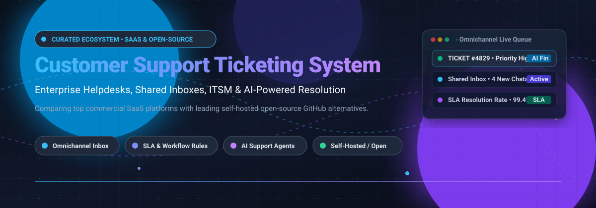

  

# 🎫 Awesome Customer Support Ticketing System

  <strong>A curated directory of top-tier SaaS platforms, self-hosted open-source helpdesks, shared inboxes, ITSM platforms, and AI-powered ticket resolution systems.</strong>

  
  
  
  
  
  
  

---

## 📌 Overview & Scope

Welcome to the **Awesome Customer Support Ticketing System** repository! 🚀 This guide tracks industry-leading **commercial SaaS platforms** and **open-source GitHub projects** designed for **Customer Support Ticketing Systems**, **Helpdesk Automation**, **Shared Inboxes**, and **IT Service Management (ITSM)**. 

Modern customer support tools empower support engineers, IT operations, and customer experience (CX) teams to consolidate multi-channel inquiries (email, live chat, WhatsApp, SMS, social channels, and web forms) into a unified queue with:
- ⚡ **Intelligent Ticket Routing & Triage** (Skill-based, round-robin, automated dispatch)
- ⏱️ **SLA & Escalation Management** (Business hours, breach alerts, response & resolution timers)
- 🤖 **AI-Driven Customer Support** (Autonomous resolution agents, Copilot draft generation, knowledge retrieval)
- 📊 **Analytics & Reporting** (CSAT, First Response Time [FRT], Mean Time to Resolution [MTTR])
- 🔒 **Data Sovereignty & Privacy** (Self-hosted on-premise deployments vs. SOC2/GDPR cloud platforms)

Whether you are looking to benchmark commercial SaaS leaders like **Zendesk**, **Freshdesk**, or **Intercom**, or deploy open-source alternatives like **Chatwoot**, **Zammad**, or **GLPI**, this list provides clear pricing, company scale, trial terms, and GitHub metrics.

---

## 📑 Table of Contents

- [📊 Sector Overview & Market Dynamics](#-sector-overview--market-dynamics)
- [☁️ SaaS / Hosted Platforms](#️-saas--hosted-platforms)
- [💻 Open-Source GitHub Projects](#-open-source-github-projects)
- [🎯 Choosing the Right Ticketing System](#-choosing-the-right-ticketing-system)
- [📈 Star History](#-star-history)
- [🤝 How to Contribute](#-how-to-contribute)
- [💖 Support & Sponsorship](#-support--sponsorship)
- [⚠️ Disclaimer](#️-disclaimer)

---

## 📊 Sector Overview & Market Dynamics

The global customer service ticketing and helpdesk software market is estimated at **$11.4B–$14.3B in 2025 and approaching $15.6B in 2026**, growing at a CAGR of ~8%–10% fueled by generative AI agents and autonomous conversation resolution. 

The competitive landscape is **moderately concentrated at the top**—where enterprise platform giants like **Atlassian (Jira Service Management)**, **Zendesk**, **Salesforce/Intercom**, and **Freshworks** command a major share of large enterprise spend—**coexisting with heavy fragmentation across mid-market, SMB, and niche verticals** (such as e-commerce-specialized **Gorgias**, collaborative inbox **Front**, and high-adoption open-source self-hosted solutions).

---

## ☁️ SaaS / Hosted Platforms

| Product | Scale (Valuation / Market Cap / Revenue) | Pricing (Starting) | Free Tier / Trial Limits | Description |
|---------|------------------------------------------|-------------------|--------------------------|-------------|
| **[Jira Service Management](https://www.atlassian.com/software/jira/service-management)** | **~$38B Market Cap** (~$5.2B+ ARR) | Standard: **$17.65/agent/month** (annual); Premium: $55.28/agent/month | **Free forever plan**: up to 3 agents, unlimited customer requests, 2 GB file storage | Atlassian's service management platform. Free forever tier for small teams; Premium adds 24/7 support, advanced automation, and incident management. |
| **[Zendesk Support](https://www.zendesk.com/)** | **~$10.2B Valuation** (~$1.6B–$2B ARR) | Support Team: **$19/agent/month** (annual); Suite Team: $55/agent/month | **14-day free trial** of Suite Professional (full feature set, no credit card required; eligible for 14-day extension via Admin Center) | Industry-standard ticketing platform with mature omnichannel queues, robust reporting, and a vast third-party integration ecosystem. |
| **[Intercom](https://www.intercom.com/)** | **~$3.6B Valuation** (~$400M+ ARR) | Essential: **$29/seat/month** (annual); Fin AI: $0.99/resolution | **14-day free trial** of Essential plan (includes up to 5 seats, full feature access, no credit card required) | AI-first customer service platform featuring **Fin AI Agent** resolving conversations autonomously alongside Copilot assistance for human agents. |
| **[Freshdesk](https://www.freshworks.com/freshdesk/)** | **~$3.2B Market Cap** (~$840M+ ARR) | Growth: **$19/agent/month** (annual); Pro: $49/agent/month | **14-day free trial** of Pro plan (includes omnichannel routing, SLA management, and 500 Freddy AI sessions, no credit card required) | Cloud helpdesk equipped with Freddy AI for automated response generation, intelligent routing, and agent productivity enhancement. |
| **[Front](https://front.com/)** | **~$1.7B Valuation** (~$100M+ ARR) | Starter: **$25/seat/month** (annual, min. 2 seats); Professional: $65/seat/month | **14-day free trial** of Professional plan (up to 10 seats, full collaboration and omnichannel features, no credit card required) | Collaborative shared inbox connecting email, SMS, and chat into an efficient team workspace with automated triage rules. |
| **[Gorgias](https://www.gorgias.com/)** | **~$710M Valuation** (~$80M+ ARR) | Starter: **$10/month** (includes 50 billable tickets); Basic: $50/month (300 tickets) | **7-day free trial** (full access to e-commerce integrations and automations, no credit card required) | E-commerce-specialized helpdesk (deep Shopify, BigCommerce, Magento integrations) automating order tracking, refunds, and ticket triage. |
| **[Help Scout](https://www.helpscout.com/)** | **~$30M+ ARR** (~$53M Total Funding) | Standard: **$25/user/month** (annual); Plus: $50/user/month | **Free plan**: up to 5 users, 1 shared inbox, 1 Docs knowledge base site; or **15-day free trial** of Plus plan (no credit card required) | Shared inbox and customer support tool prioritizing conversational simplicity, built-in Docs knowledge base, and AI draft assistants. |
| **[HappyFox](https://www.happyfox.com/)** | **~$20M ARR** (Bootstrapped / Profitable) | Basic: **$24/agent/month** (annual, min. 5 agents); Team: $49/agent/month | **14-day free trial** of Enterprise tier (full ticketing and SLA workflow automation features, no credit card required) | Practical helpdesk ticketing platform featuring robust workflow automations, SLA tracking, and multi-brand customer portal management. |
| **[LiveAgent](https://www.liveagent.com/)** | **~$15M+ ARR** (Quality Unit, Bootstrapped) | Small Business: **$15/agent/month** (annual); Team: $29/agent/month | **Free forever plan**: 1 agent, 1 email account, 1 chat button, 7-day ticket history; or **30-day free trial** of Large plan (no credit card required) | Omnichannel helpdesk with built-in live chat, call center, and ticketing. AI assistant connects to your own API key with zero resolution markups. |
| **[Deskpro](https://www.deskpro.com/)** | **~$10M ARR** ($25M Series A Funding) | Team: **$39/agent/month** (annual, min. 5 agents); Professional: $69/agent/month | **14-day free trial** of Professional Cloud or On-Premise deployment (full omnichannel capabilities, no credit card required) | Flexible multi-channel helpdesk software offering complete deployment choice across Cloud and self-hosted on-premise environments. |

---

## 💻 Open-Source GitHub Projects

| Project | Star Badge | Description |
|---------|------------|-------------|
| **[Chatwoot](https://github.com/chatwoot/chatwoot)** |  | **The leading open-source customer engagement suite and omnichannel inbox.** ~39.8k stars. Built with Ruby on Rails and Vue.js. Unifies live website chat, email, WhatsApp, Telegram, Facebook, and Instagram into one inbox with multi-brand support, canned responses, agent automations, and mobile apps. |
| **[UVdesk](https://github.com/uvdesk/community-skeleton)** |  | **Full-featured open-source helpdesk on Symfony/PHP.** ~19.6k stars. Designed with modular bundle architecture, customer self-service portal, knowledge base, and multi-channel email ticketing. Well-suited for e-commerce platforms (Magento, Shopify integrations). |
| **[GLPI](https://github.com/glpi-project/glpi)** |  | **Mature open-source ITSM and IT asset management platform.** ~6.6k stars. PHP/MariaDB. Combines service desk ticket management, SLA/SLO tracking, problem/change management, and CMDB asset inventory into an enterprise-grade ITIL-aligned solution. |
| **[Papercups](https://github.com/papercups-io/papercups)** |  | **Open-source live customer messaging platform.** ~6.1k stars. Elixir/Phoenix and React/TypeScript. Privacy-friendly live chat widget, Slack bidirectional integration, email ticketing, and customizable conversation flows. |
| **[Zammad](https://github.com/zammad/zammad)** |  | **The cleanest open-source ticketing interface, closest to commercial SaaS.** ~6.1k stars. AGPL-3.0, Ruby on Rails. Multi-channel intake (email, chat, phone, social media), ITIL-aligned workflows, time accounting, knowledge base, and SLA management with zero feature paywalls. Requires 4–8 GB RAM. |
| **[FreeScout](https://github.com/freescout-help-desk/freescout)** |  | **The best lightweight open-source Help Scout/Zendesk alternative.** ~4.7k stars. PHP/Laravel. No limits on users, tickets, or mailboxes. Runs smoothly on 1–2 GB RAM and shared hosting. Supports email, WhatsApp, Telegram, live chat, and marketplace modules including AI integration. |
| **[osTicket](https://github.com/osTicket/osTicket)** |  | **The most established open-source email-to-ticket system.** ~4.0k stars. PHP/MySQL. Battle-tested since 2013, routes inquiries from emails, web forms, and phone into a straightforward multi-agent queue with custom SLA plans, routing filters, and client portals. |
| **[Frappe Helpdesk](https://github.com/frappe/helpdesk)** |  | **Modern ticketing built on the Frappe framework, ideal for ERPNext users.** ~3.5k stars. AGPL-3.0. Features dual agent/customer portals, customizable SLA timers, automated ticket routing, knowledge base, saved responses, and native customer record synchronization with ERPNext. |
| **[Peppermint](https://github.com/Peppermint-Lab/peppermint)** |  | **Modern lightweight helpdesk and issue management solution.** ~3.2k stars. Built with Next.js, React, Node.js, and Prisma/PostgreSQL. Offers SMTP/IMAP inbound ticket conversion, markdown notes, client interaction timelines, and OIDC authentication. |
| **[Trudesk](https://github.com/polonel/trudesk)** |  | **Real-time open-source helpdesk platform.** ~1.5k stars. Node.js and MongoDB. Built with modern web technologies, providing live ticket updates via WebSockets, customer portal, SLA tracking, and internal team chat. |
| **[Request Tracker (RT)](https://github.com/bestpractical/rt)** |  | **Industrial-grade, high-volume open-source issue tracking and ticketing system.** ~1.2k stars. Perl. Used by Fortune 500s, universities, and government agencies worldwide for custom approval workflows, email automation, PGP/S/MIME encryption, and granular access control. |
| **[Znuny](https://github.com/znuny/Znuny)** |  | **Full ITIL service desk and audit-proof ticketing.** ~610 stars. GPL-3.0 fork of OTRS Community Edition. Features unchangeable communication logs, strict audit trails, SAML authentication, and advanced ITSM workflows for regulated enterprise environments. |
| **[OTOBO](https://github.com/RotherOSS/otobo)** |  | **Enterprise IT service management and ticketing system forked from OTRS.** ~340 stars. Modern responsive customer portal, free ITSM add-ons, OpenID Connect/SAML authentication, and CMDB integration. Best for IT operations requiring 8–16 GB RAM production scale. |

---

## 🎯 Choosing the Right Ticketing System

- **Omnichannel Real-Time Chat & Social:** Go with **[Chatwoot](https://github.com/chatwoot/chatwoot)** or **[Papercups](https://github.com/papercups-io/papercups)** for self-hosted messaging; **[Intercom](https://www.intercom.com/)** or **[Front](https://front.com/)** for SaaS.
- **ITSM & ITIL Service Desk:** Choose **[GLPI](https://github.com/glpi-project/glpi)** or **[Znuny](https://github.com/znuny/Znuny)** for open-source asset + ticket tracking; **[Jira Service Management](https://www.atlassian.com/software/jira/service-management)** for enterprise DevOps integration.
- **SaaS-Class Experience with Self-Hosting:** Choose **[Zammad](https://github.com/zammad/zammad)** for its modern web app interface, or **[FreeScout](https://github.com/freescout-help-desk/freescout)** for minimal server overhead (1–2 GB RAM).
- **ERP Integration:** Deploy **[Frappe Helpdesk](https://github.com/frappe/helpdesk)** for native single-pane synchronization with ERPNext accounts and contacts.
- **Classic Email-to-Ticket Simplicity:** Deploy **[osTicket](https://github.com/osTicket/osTicket)** or **[Peppermint](https://github.com/Peppermint-Lab/peppermint)**.

---

## 📈 Star History

---

## 🤝 How to Contribute

Contributions are warmly welcomed! Help keep this customer support ticketing ecosystem comprehensive, up-to-date, and accurate:

1. 🍴 **Fork** this repository.
2. 🌿 **Create a branch** for your feature or update (`git checkout -b feature/add-new-ticketing-system`).
3. 📝 **Add or update** entries in `README.md` following the existing format, table sorting criteria, and markdown structure.
4. ✅ **Ensure accuracy**: Verify that URLs, pricing tiers, trial terms, or GitHub metrics are factual and verifiable.
5. 🚀 **Submit a Pull Request** with a brief summary explaining your changes.

---

## 💖 Support & Sponsorship

If you found this curated list helpful for your organization, support operations, or engineering stack, consider supporting the maintenance of this repository! 🌟

- ⭐ **Star this repository** to help others discover it on GitHub.
- 🍴 **Fork and share** it with fellow DevOps engineers, support operations leads, and developers.
- ☕ **Sponsor or Buy a Coffee**: Support ongoing development and open-source curation on the [GitHub Sponsor Dashboard](https://github.com/sponsors/ishandutta2007).

---

## ⚠️ Disclaimer

- This is an independent, community-curated list — not an official endorsement of any vendor or project.
- Customer support and helpdesk platforms process personally identifiable information (PII) and customer data; ensure compliance with GDPR, HIPAA, CCPA, and your organization's data governance standards.
- **Open-source ticketing TCO is not zero:** Factor in infrastructure hosting, system updates, backup redundancy, security patching, and administrative maintenance.
- **SaaS pricing models are rapidly evolving:** Verify all current pricing tiers, seat minimums, and AI resolution fees directly on official vendor pricing pages before committing.

---

  Maintained with ❤️ by <a href="https://github.com/ishandutta2007">Ishan Dutta</a> and the global open-source support engineering community.

